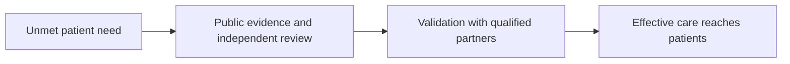
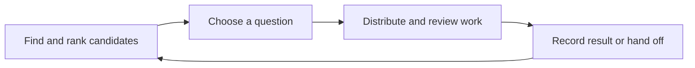

<picture>
  
</picture>

# Remedy Atlas

**Solve disease. Save lives.**

Someone is waiting for a better answer. Remedy Atlas is an open research network bringing people together to find it. We look for places where a better treatment or a better way to deliver care could save lives, and share the work of reading the evidence and testing what it can tell us.

[**Live roadmap**](https://remedy-atlas.tomoliveri.workers.dev/#roadmap) · [**Contribute**](.github/CONTRIBUTING.md) · [**Technical overview**](docs/technical-overview.md)

## Crowdsourced research stays open

**Free findings. No exclusive ownership by pharma. Affordable care is the goal.** Original research that contributors have rights to share will be available under CC BY 4.0. We require an affordable access plan from research partners and publish the commitments we can secure. [Open research commitment](docs/open-research.md)

## Why it matters

Snakebite kills an estimated **81,000–138,000 people a year**. Preventing even 1% of those deaths would mean **810–1,380 more people alive each year**. That gives a sense of scale. Our first snakebite track asks whether targeting venom metalloproteinases could add protection alongside sPLA₂ inhibition and standard care. In parallel, the NDM-1 and KPC/OXA tracks ask who still needs better options for carbapenem-resistant infections. [WHO snakebite mortality estimate](https://www.who.int/news/item/01-09-2024-better-snakebite-data-needed-to-save-lives-and-limbs)

A promising result can guide independent validation or help a clinical partner decide what to test next. For patients to benefit, an improvement must work compared with current care and reach the people who need it.



The dashboard shows the work in progress, reported disease burden, and what the assumptions behind an annual lives-saved scenario imply. Clinical evidence is needed to determine actual benefit.

## How the network keeps going

Workstead distributes research tasks and records what we learned. Each week the network searches recent literature for new leads. Contributors review which questions could save lives, what evidence is missing, and who could help answer them. When there’s room, the queue opens the highest-priority track that maintainers have already approved.



**Beyond the first targets.** The initial portfolio also includes LpxC for Gram-negative infections, drug-resistant TB, *C. difficile*, *Candida auris*, and malaria. We are opening our first cancer research track on cervical screening and follow-up. Lung and liver cancer are candidates for expansion as capacity and clinical partnerships grow. Cancer caused an estimated **9.8 million deaths worldwide in 2024**. Our first cancer projects would need a specific patient population, a gap we can address, and a clear route to validation. [Candidate register](docs/candidates.md) · [IARC global cancer statistics](https://www.iarc.who.int/news-events/global-cancer-statistics-2024-globocan-estimates-of-incidence-and-mortality-worldwide-for-34-cancers-in-186-countries)

## How to help

Pick an evidence question from the [ready queue](https://github.com/tomoliveri/remedy-atlas/issues?q=is%3Aissue+is%3Aopen+label%3Aws%3Aready), help review a finding, or propose a more promising candidate.

<details>
<summary>Join with an AI worker</summary>

```text
Read https://raw.githubusercontent.com/tomoliveri/remedy-atlas/main/docs/JOIN.md and follow it. Ask for my consent up front, then keep taking eligible research and review tasks while work is available or until I ask you to stop.
```

</details>

Built on [Workstead](https://github.com/tomoliveri/workstead) · [MIT license](LICENSE)
