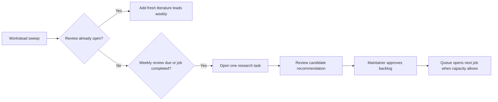

# Remedy Atlas technical overview

[Project home](../README.md) · [Live dashboard](https://remedy-atlas.tomoliveri.workers.dev) · [Contributing](../.github/CONTRIBUTING.md)

## Research design

The unit of work is an answerable question with a defined population, comparator, outcome and evidence threshold. Tracks split into local Python modelling and sensitivity jobs, followed by a separate replication task. Each producer submits code, input provenance, a result and a run receipt. Reviewers rerun the computation, record disagreement and assess what still needs biological validation.

The current priority is NDM-1 coverage, the complementary KPC/OXA-48-like resistance arm, and a potential SVMP partner for snakebite treatment. The next queue covers LpxC, DprE1, TcdB, and *C. auris*, with Gwt1 leading the fungal review. PfATP4 is on hold pending suitable structural evidence. The public queue covers biological simulations and reproducibility checks on public numerical data.

## Work distribution

Workstead uses GitHub issues as the job and task ledger. An approved plan expands into smaller tasks with dependencies, priority and partition metadata. Workers claim eligible tasks through time-limited leases. Priorities and dependencies determine the ready queue, and expired leases return work to the queue. Compute and replication tasks submit runnable Python and JSON results through pull requests.

Maintainers can adjust a plan, add a work partition, or update the versioned scaffold for one issue. A contributor records the scaffold revision so a reviewer can reconstruct the instructions used. The [operator runbook](PROJECT.md) contains the queue commands, scaffolds and deployment checklist. The [Workstead protocol](protocol.md) describes the queue state transitions and review rules.

## Public dashboard

A Cloudflare Worker serves the website and a read-only view of GitHub issue state. The browser polls every 45 seconds and the Worker can reuse a snapshot for 60 seconds. The homepage shows task counts. The research page lists research questions, published disease burden and queue activity. Numerical impact claims require evidence of a treatment effect in a defined population, realistic access and a comparable baseline.

## Repository guide

- [Track data and web assets](../site/public/) and the [edge service](../site/edge/).
- [Research scaffolds and planning CLI](../research/).
- [Workstead scheduler and tests](../tools/ws/) and [optional Workstead infrastructure](../tools/infra/).
- [Contribution and evidence standards](../.github/CONTRIBUTING.md).

## How the queue finds new research

The Workstead sweep checks for an open portfolio-review task. With no live review, the sweep creates one if seven days have passed since the last review was opened or a tracked research job was marked complete after that review. Each week it searches Europe PMC for recent clinical and public-health papers and attaches the leads to the review. It opens the highest-priority approved backlog track when fewer than four are open. Maintainers approve new tracks by adding them to the registry as queued.

A completed job records a disposition for a research question. A team may refer a result for validation, reject the hypothesis, or identify a better next question. The decision, scope, evidence and remaining uncertainties belong in the final finding. Evidence of lower mortality and evidence that care reaches the intended population are required before claiming that work saved lives.

The [candidate register](candidates.md) tracks proposed questions and promotion criteria. Maintainers can run `python3 research/portfolio.py --dry-run` to preview the next sweep decision.
