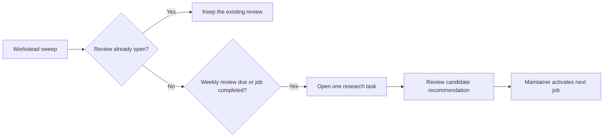

# Remedy Atlas technical overview

[Project home](../README.md) · [Live dashboard](https://remedy-atlas.tomoliveri.workers.dev) · [Contributing](../.github/CONTRIBUTING.md)

## Research design

The unit of work is an answerable question with a defined population, comparator, outcome and evidence threshold. Tracks begin with public evidence extraction and impact assessment. A synthesis task reconciles those results, documents contradictory evidence, and identifies what still needs independent validation. Reviews record negative results and uncertainty alongside promising findings.

The current priority is NDM-1 coverage, the complementary KPC/OXA-48-like resistance arm, and a potential SVMP partner for snakebite treatment. The next queue covers LpxC, DprE1, TcdB, and *C. auris*, with Gwt1 leading the fungal review. PfATP4 is on hold pending suitable structural evidence. The public queue covers literature, clinical and epidemiological evidence, and reproducibility checks on published aggregate data.

## Work distribution

Workstead uses GitHub issues as the job and task ledger. An approved plan expands into smaller tasks with dependencies, priority and partition metadata. Workers claim eligible tasks through time-limited leases. Priorities and dependencies determine the ready queue, and expired leases return work to the queue. Evidence and impact tasks submit written results for review. Synthesis tasks use pull requests and run repository checks.

Maintainers can adjust a plan, add a work partition, or update the versioned scaffold for one issue. A contributor records the scaffold revision so a reviewer can reconstruct the instructions used. The [operator runbook](PROJECT.md) contains the queue commands, scaffolds and deployment checklist. The [Workstead protocol](protocol.md) describes the queue state transitions and review rules.

## Dashboard and impact model

A Cloudflare Worker serves the application and a read-only view of GitHub issue state. The browser polls every 45 seconds. The Worker can reuse a snapshot for 60 seconds. The track registry carries phase, scope, baseline evidence and impact inputs. Queue updates appear automatically. Changes to the track registry are published with a Worker deployment.

The lives-saved ranges use one of two baselines:

- **Mortality baseline.** Multiply annual deaths by the eligible fraction, treatment reach, and relative mortality reduction versus current care.
- **Case baseline.** Multiply annual clinical detections by the eligible fraction, treatment reach, and the absolute reduction in mortality risk. This path applies where credible annual target-specific death counts are unavailable.

Each card gives the geography, reference year or reporting period, baseline source and model inputs. The illustrative cases use shared sensitivity assumptions because target-specific eligibility, reach and benefit are still unknown. The displayed endpoints combine low inputs together and high inputs together. They are scenario outputs, and actual benefit may be zero. Overlapping conditions and resistance mechanisms can count the same patient, so ranges cannot be summed.

## Repository guide

- [Track data and web assets](../site/public/) and the [edge service](../site/edge/).
- [Research scaffolds and planning CLI](../research/).
- [Workstead scheduler and tests](../tools/ws/) and [optional Workstead infrastructure](../tools/infra/).
- [Contribution and evidence standards](../.github/CONTRIBUTING.md).

## How the queue finds new research

The Workstead sweep checks for an open portfolio-review task. With no live review, the sweep creates one if seven days have passed since the last review was opened or a tracked research job was marked complete after that review. A review that is already open takes precedence, so the queue has at most one automatically generated review at a time.

A completed job records a disposition for a research question. A team may refer a result for validation, reject the hypothesis, or identify a better next question. The decision, scope, evidence and remaining uncertainties belong in the final finding. Evidence of lower mortality and evidence that care reaches the intended population are required before claiming that work saved lives.

The [candidate register](candidates.md) tracks proposed questions and promotion criteria. Maintainers can run `python3 research/portfolio.py --dry-run` to preview the next sweep decision.
